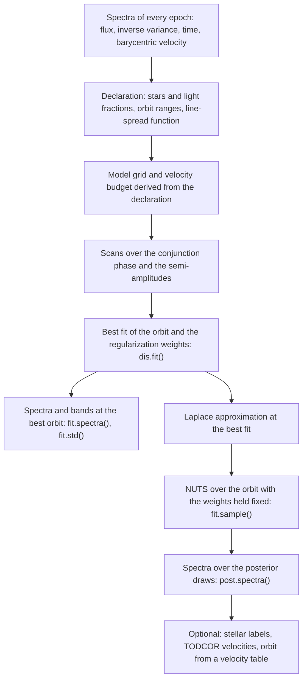

# Method overview

albireo separates the spectra of the stars in a spectroscopic binary from a time series of
composite spectra and determines the orbit at the same time. It follows the scheme of the
wavelength-space disentangling codes (Simon & Sturm 1994; Sablowski & Weber 2017; Seeburger
et al. 2024): for a trial orbit the component spectra follow from a linear least-squares
problem, and the orbit is adjusted in an outer, nonlinear fit. This page describes the scheme
step by step, with a simulated binary carried through every section, and states where albireo
departs from it. There are three departures; the statistical terms they use are defined in the
[glossary](#14-glossary) at the end.

1. The smoothing penalty on the component spectra is read as a Gaussian prior. The regularized
   solution is then the posterior mean of the spectra, and the matrix factorized to compute it
   gives their covariance, so every disentangled spectrum has an uncertainty band
   ([Section 5](#5-the-penalty-as-a-prior)).
2. The strength of the smoothing is fitted to the data, by maximizing the marginal likelihood,
   instead of being chosen by hand ([Section 7](#7-the-regularization-strength)).
3. The orbit is sampled by Markov chain Monte Carlo, not only optimized. The spectra are
   integrated out at every step, so the sampler explores only the orbital parameters
   ([Section 8](#8-uncertainties-on-the-orbit)).

PSOAP (Czekala et al. 2017) introduced a probabilistic treatment of this kind for short
spectral segments; the [comparison](comparison.md) sets albireo beside it and the other
disentangling codes. The equations are derived in the [mathematical foundations](math.md),
and the [benchmark record](benchmarks.md) documents the tests on simulated and observed
spectra (Section 8 summarizes the calibration of the uncertainties).

## 1. The running example

The package ships a simulated double-lined binary: 12 epochs over 14.85 d from one
instrument (`DEMO`), 4505 to 4555 Å at a signal-to-noise ratio of 80, with an injected orbit
of $`P = 6.0`$ d, $`e = 0.15`$, $`\omega = 0.7`$ rad, $`K_1 = 42.0`$ and $`K_2 = 63.0`$ km/s,
light fractions 0.62 and 0.38, and a Gaussian line-spread function (LSF) of
$`\sigma = 6.5`$ km/s. Times are in days from the first epoch, and the injected time of
conjunction (Section 8) is 0.628 d. The spectra were simulated with the same model that is
fitted, so the example tests the method, not its agreement with real stars; the
[benchmark record](benchmarks.md) reports analyses of observed spectra of HR 6819 and
AI Phoenicis. It is declared and fitted as in the [quickstart](quickstart.md):

```python
import albireo as ab

dataset, truth = ab.load_example("sb2_sim", with_truth=True)
dis = ab.Disentangler(
    dataset,
    components=[ab.Star("primary", light=0.62), ab.Star("secondary", light=0.38)],
    orbit=ab.Orbit(period=ab.Between(5.5, 6.5), k=ab.Between([10.0, 10.0], [90.0, 90.0])),
    lsf={"DEMO": 6.5},
)
fit = dis.fit()            # best fit of the orbit and of the regularization weights
post = fit.sample(seed=0)  # posterior over the orbit
```

The figures on this page are made from this run by
[`scripts/build_method_figures.py`](https://github.com/tjayasinghe/albireo/blob/main/scripts/build_method_figures.py).

## 2. The data model

Each epoch $`j`$ provides a spectrum on its own wavelength pixels: a flux $`y_j`$ normalized
to the continuum, its inverse variance $`w_j`$ (zero marks a masked pixel), the time, and the
barycentric correction. albireo describes star $`i`$ by the deviation of its normalized
spectrum $`s_i`$ from the continuum, $`d_i = s_i - 1`$, on a model grid uniform in
$`\ln\lambda`$, where a Doppler shift is a translation. The pixel of the model grid defaults to
the finest pixel of the data (3.97 km/s in the example), and shifts by fractions of a pixel use
linear interpolation. The model of epoch $`j`$ is

```math
y_j \;=\; \mathbf{R}_j \Big[\, \mathbf{1} \;+\; \sum_i \ell_i\, \mathbf{B}_j\, \mathbf{T}(v_{ij})\, d_i \Big] \;+\; n_j ,
```

where $`\mathbf{T}(v_{ij})`$ shifts star $`i`$ to its radial velocity at epoch $`j`$,
$`\mathbf{B}_j`$ convolves with the LSF of the instrument, $`\ell_i`$ is the star's fraction
of the continuum light (the fractions sum to 1), $`\mathbf{R}_j`$ integrates the model over the
epoch's own pixels, and $`n_j`$ is noise of variance $`1/w_j`$. The spectra are therefore
defined before the instrumental broadening. Optional terms, not used in the example, add a
telluric spectrum at rest in the observatory frame, a nebular emission spectrum with a free
strength at each epoch, and a multiplicative polynomial per epoch for errors of the continuum
normalization; [math.md §1](math.md#1-the-forward-model) gives the complete model. The data are
not resampled: the model is carried to each epoch's pixels, so masks and chip gaps need no
special treatment, and spectra from different instruments enter with their own pixels and
LSF (their wavelength calibrations must agree).

[](method/figures/fig01-epochs-light.png)
[](method/figures/fig01-epochs-dark.png)

*Figure 1.* Two epochs of the example, at the widest and the narrowest separation of the two
stars. Grey points are the data, the black line is the model, and the colored lines are the
contributions of the two stars, each its light fraction times its shifted and broadened
spectrum; the two contributions sum to the model. The lower panels show the residuals in
units of the noise. One pair of component spectra describes both epochs.

## 3. The linear step: spectra for a given orbit

For a fixed orbit every shift is fixed, and the model is linear in the unknown spectra.
Stacking all epochs and both stars,

```math
y = a_0 + \mathbf{A}\, d + n ,
```

where $`a_0`$ is the continuum, $`d = (d_1, d_2)`$ are the two deviation spectra, and
$`\mathbf{A}`$ is the design matrix, whose block for epoch $`j`$ and star $`i`$ is
$`\ell_i \mathbf{R}_j \mathbf{B}_j \mathbf{T}(v_{ij})`$. This is the formulation of Simon &
Sturm (1994), written $`M\vec{x} = \vec{c}`$ in Eq. 6 of Seeburger et al. (2024).
$`\mathbf{A}`$ is sparse (Figure 2): each data pixel depends on a few model pixels of each star,
at positions that move with the star's velocity. albireo never forms $`\mathbf{A}`$ as a matrix
and applies it as a sequence of shift, convolution and rebinning operations.

The spectra that fit this orbit best minimize the weighted misfit

```math
\chi^2(d) = (\tilde y - \mathbf{A} d)^\top\, \mathbf{W}\, (\tilde y - \mathbf{A} d),
\qquad \tilde y = y - a_0, \quad \mathbf{W} = \mathrm{diag}(w),
```

an ordinary weighted linear least-squares problem. On its own the problem has two defects.
Its solution is not unique: a constant can be moved from one star's spectrum to the other's
without changing the model, and features broader than the spread of the stars' velocity
difference over the epochs are almost as free
([math.md §5.1](math.md#51-the-low-frequency-degeneracy-the-undulations-theorem)). Small errors
of the continuum normalization are amplified along these directions, which is the origin of
the low-frequency undulations of Fourier-disentangled spectra (Hensberge et al. 2008). Without
a constraint between neighboring pixels, the solution also reproduces the noise of the data
as structure in the spectra.

[](method/figures/fig02-structure-light.png)
[](method/figures/fig02-structure-dark.png)

*Figure 2.* The structure of the linear problem for a small simulated binary (two stars, three
epochs of 50 pixels, 121 model pixels per star, velocity differences up to 83 km/s). Left: the
design matrix $`\mathbf{A}`$, with the data pixels of the three epochs as rows and the model
pixels of the primary and then the secondary as columns; each block is a band whose position
follows the star's velocity at that epoch. Middle: the matrix
$`\boldsymbol\Lambda + \mathbf{A}^\top\mathbf{W}\mathbf{A}`$ of the regularized problem
(Section 4). Its off-diagonal blocks couple the two stars, with one stripe per epoch at the
relative velocity of the stars. Right: the same matrix with the pixels of the two stars
interleaved, which makes it a single band. albireo factorizes the band in blocks (dotted
lines), at a cost proportional to the number of pixels for a given width of the band, which is
set by the largest velocity difference between the stars that the priors allow.

## 4. Regularization

albireo adds two penalties to the misfit:

```math
\chi^2(d) \;+\; \sum_i \Big( \tau_i \,\lVert \mathbf{D}_2\, d_i \rVert^2 \;+\; \eta_i \,\lVert d_i \rVert^2 \Big),
```

where $`\mathbf{D}_2`$ takes second differences of neighboring pixels. The first term penalizes
curvature, that is, structure on the scale of a few pixels, with the curvature weight
$`\tau_i`$. The second pulls the spectrum toward the continuum with the continuum weight
$`\eta_i`$, whose inverse square root is the spread it allows a pixel about the continuum (0.3
of the continuum for $`\eta_i = 10`$). It fixes the constant and the slope, which the curvature
penalty does not penalize and which the data assign to either star weakly or not at all
(Section 3). The minimum solves the linear system

```math
\big(\boldsymbol\Lambda + \mathbf{A}^\top \mathbf{W} \mathbf{A}\big)\, \hat d = \mathbf{A}^\top \mathbf{W}\, \tilde y,
\qquad
\boldsymbol\Lambda = \mathrm{diag}_i\big(\tau_i\, \mathbf{D}_2^\top \mathbf{D}_2 + \eta_i\, \mathbf{I}\big).
```

The curvature term is the Tikhonov penalty $`\gamma \lVert L\vec{x} \rVert^2`$ of Seeburger et
al. (2024, Eqs. 8 and 9), whose $`L`$ is a second-difference operator: the same regularization
of the same linear problem. Compared with their formulation, albireo weights the misfit by the
inverse variances, adds the continuum term, and determines the weights $`\tau_i`$ and $`\eta_i`$
from the data (Section 7). Figure 3 shows the effect of the curvature weight on the example.

[](method/figures/fig03-regularization-light.png)
[](method/figures/fig03-regularization-dark.png)

*Figure 3.* The component spectra of the example at the best-fit orbit, for the curvature
weight $`\tau`$ fitted to the data (middle) and for $`\tau`$ a hundred times smaller (left) and
larger (right). The colored line is the regularized solution $`\hat d`$, the band its
$`\pm 1\sigma`$ uncertainty (Section 5), and the dashed line the injected spectrum. Too small a
weight leaves the noise of the data in the spectra, under a wide band. Too large a weight makes
the narrow lines shallower, and the band, which is conditional on the prior, becomes too narrow
to contain the injected spectrum: the band is a valid uncertainty only at a weight the data
support.

## 5. The penalty as a prior

The penalized least-squares problem of Section 4 has a probabilistic reading. With Gaussian
noise, the misfit is $`-2\ln`$ of the likelihood, $`\ln p(y \mid d) = -\chi^2(d)/2 + \mathrm{const}`$.
The penalty is $`-2\ln`$ of a Gaussian prior on the spectra, with mean zero (the continuum)
and inverse covariance $`\boldsymbol\Lambda`$:

```math
p(d) \;\propto\; \exp\!\big(-\tfrac12\, d^\top \boldsymbol\Lambda\, d\big).
```

The penalized objective is therefore $`-2\ln`$ of the posterior of the spectra at the given
orbit (the conditional posterior), up to a constant. This posterior is Gaussian, and three
consequences follow.

1. The regularized solution $`\hat d`$ is the posterior mean of the spectra at that orbit
   (`fit.spectra()`): the minimum of the penalized objective is the peak of a Gaussian, which
   is also its mean.
2. The inverse covariance of the posterior is
   $`\boldsymbol\Lambda + \mathbf{A}^\top\mathbf{W}\mathbf{A}`$, the matrix factorized to
   compute $`\hat d`$. The variance of every pixel follows from the same factor by one further
   recursion of similar cost (`fit.std()` and the bands of Figure 3), and the correlations
   between pixels and between the two stars are available from it. The band depends on the
   orbit, the noise, the light fractions, the coverage and the prior, but not on the fluxes. It is wide
   where the data constrain the spectrum weakly: at the edges of the coverage and in masked
   pixels, for the fainter star, and for the broad features of Section 3, whose uncertainty is
   set by $`\eta_i`$.
3. The weights $`\tau_i`$ and $`\eta_i`$ are parameters of a prior, which can be estimated from
   the data (Section 7).

Reading the penalty as a prior changes no number in the solution. It gives the regularization a
probabilistic meaning, from which the band of point 2 and the estimate of point 3 follow. The
band differs from the scatter of $`\hat d`$ under repeated noise, which a least-squares
analysis would quote,
$`(\boldsymbol\Lambda + \mathbf{A}^\top\mathbf{W}\mathbf{A})^{-1}\mathbf{A}^\top\mathbf{W}\mathbf{A}\,(\boldsymbol\Lambda + \mathbf{A}^\top\mathbf{W}\mathbf{A})^{-1}`$.
The posterior covariance is that scatter plus the term
$`(\boldsymbol\Lambda + \mathbf{A}^\top\mathbf{W}\mathbf{A})^{-1}\boldsymbol\Lambda\,(\boldsymbol\Lambda + \mathbf{A}^\top\mathbf{W}\mathbf{A})^{-1}`$,
which accounts, on average over the prior, for the bias that the regularization introduces.

## 6. The objective for the orbit

Codes based on $`\chi^2`$ choose the orbit that minimizes the misfit of the best spectra for
that orbit, $`\chi^2(\hat d(\theta))`$, where $`\theta`$ denotes the nonlinear parameters
(period, time of conjunction, eccentricity, argument of periastron and semi-amplitudes).
Seeburger et al. (2024, Eq. 12) minimize it over the primary's velocity at each epoch and the
mass ratio with a downhill simplex, and shift-and-add analyses evaluate it on a grid of
$`(K_1, K_2)`$.

albireo uses instead the probability of the data for given $`\theta`$, with the spectra
integrated out, which is called the marginal likelihood:

```math
p(y \mid \theta) = \int p(y \mid d, \theta)\; p(d)\; \mathrm{d}d .
```

Because the model is linear in $`d`$ and both factors are Gaussian, the integral has a closed
form ([math.md §3.1](math.md#31-derivation)):

```math
-2\ln p(y \mid \theta) \;=\;
\underbrace{\chi^2(\hat d) + \hat d^\top \boldsymbol\Lambda\, \hat d}_{\text{misfit and penalty at } \hat d}
\;+\;
\underbrace{\ln\det\big(\boldsymbol\Lambda + \mathbf{A}^\top\mathbf{W}\mathbf{A}\big) - \ln\det\boldsymbol\Lambda}_{\text{Occam term}}
\;+\; \mathrm{const}.
```

The first part is the penalized $`\chi^2`$ of Section 4 at its minimum. The second, the Occam
term, measures the freedom of the spectra to fit the data: it grows with the number of
spectral features that the data determine and with how tightly they determine them.
Integrating the spectra out therefore amounts to solving for them exactly at each trial orbit
(the first part) and charging for their freedom (the second part).

At fixed regularization weights the first part dominates the choice of the orbit. The Occam
term changes with the orbit mainly through the relative velocities of the stars, which set
how well the data separate them. It favors smaller velocity separations, and in the example its
gradient at the best fit moves the semi-amplitudes toward smaller values by 0.011 and 0.006
km/s, 0.2 and 0.07 of their posterior standard deviations. The Occam term matters for the
parameters that
change how flexible the spectra are: the regularization weights and, where they are fitted
through the low-level interface, light fractions that vary between epochs, LSF widths relative
to a reference instrument, and a rescaling of the supplied noise variances
([math.md §3](math.md#3-marginalizing-the-spectra-analytically)). For the regularization
weights, $`\chi^2`$ alone always prefers the weakest regularization, because a more flexible
spectrum never fits worse (Figure 4, left), and the Occam term is what makes their estimate
well defined.

## 7. The regularization strength

Seeburger et al. (2024) set their regularization weight by trial and error, so that the
regularized solution fits within $`\Delta\chi^2 \approx 3`$ of the unregularized one, and list
its automation as future work. Shift-and-add has no explicit regularization and no stopping
rule, and stopping early leaves spurious line wings and wrong line strengths (Quintero, Eenens
& Rauw 2020). In albireo the weights $`\tau_i`$ and $`\eta_i`$ are fitted: the best fit
maximizes the marginal likelihood over the orbit and the weights together. Estimating the
parameters of a prior by maximizing the marginal likelihood is called type-II maximum
likelihood (ML-II) or empirical Bayes (MacKay 1992). Strictly, the fit also includes the
priors of the orbit and a broad prior on each weight (below), so it is the maximum of the
posterior of the orbit and the weights together (the MAP of Section 8); with priors this broad
the difference from ML-II is small.

[](method/figures/fig04-evidence-light.png)
[](method/figures/fig04-evidence-dark.png)

*Figure 4.* The marginal likelihood of the example against the curvature weight of both stars,
in units of its fitted value, with the orbit and the continuum weights held at the best fit.
Left: the data misfit $`\chi^2`$ at the regularized solution, per pixel. It rises
monotonically, from 0.959 at a thousandth of the fitted weight to 1.450 at a hundred times it,
and is 0.995 at the fitted weight. Right: the log marginal likelihood (black) and its two
parts in the same units, $`-(\chi^2 + \text{penalty})/2`$ at the regularized solution (blue) and
the Occam term,
$`-\tfrac12[\ln\det(\boldsymbol\Lambda + \mathbf{A}^\top\mathbf{W}\mathbf{A}) - \ln\det\boldsymbol\Lambda]`$
(orange), each relative to its value at the fitted weight. The marginal likelihood is largest
at the fitted weight, on a grid of steps of a factor of 1.8; it is lower by 209 nats at a tenth
of that weight and by 672 nats at ten times it.

The fitted weights are reported by `fit.summary()`, with the distance of each from the centre
of its hyperprior in units of the width of the hyperprior. The hyperprior is a
broad log-normal prior (a factor of about 20 per standard deviation); it keeps the optimizer
away from extreme ratios of the two weights, at which the linear algebra loses precision
([math.md §3.1](math.md#31-derivation)). For the example:

```
Regularization weights of the component spectra, fitted by maximizing the marginal
likelihood (ML-II) and held fixed for sampling: curvature weight tau and continuum weight
eta, centre -> fitted, with the moves in ln tau and ln eta in hyperprior standard deviations
  primary        tau       300 ->       638 (+0.25 sigma)   eta        5 ->     10.2 (+0.24 sigma)
  secondary      tau       300 ->  1.15e+03 (+0.45 sigma)   eta        5 ->     3.25 (-0.14 sigma)
```

A curvature weight that moved by less than 0.02 hyperprior standard deviations is flagged: the
data may not constrain it, and its start then deserves a check. A continuum weight that fell
more than one hyperprior standard deviation below its centre is flagged as well, in a model of
two or more components. It is the only term of the prior that holds the constant and the slope
of a component, and its fall lets continuum errors that differ between epochs into the
components (Section 10). `Smoothness(eta_min=...)` bounds it from below, and a fitted value at
the bound is reported. The weights are defined per
pixel of the model grid, so their values depend on its pixel size; the fitted spectrum and its
band (Figure 3) are the quantities to inspect.
When albireo samples the orbit (Section 8) it holds the weights at these values. This is a
plug-in approximation: the orbital uncertainties do not include the uncertainty of the weights.

## 8. Uncertainties on the orbit

The orbital parameters of an SB2 are $`\theta = (P, T_\mathrm{conj}, \sqrt{e}\cos\omega,
\sqrt{e}\sin\omega, K_1, K_2)`$. $`T_\mathrm{conj}`$ is the time at which the true anomaly
$`\nu`$ of the first star satisfies $`\nu + \omega = \pi/2`$, its superior conjunction, in the
time system of the data; $`\omega`$ is the argument of periastron of the first star (the second
star's is $`\omega + \pi`$), and the pair $`(\sqrt{e}\cos\omega, \sqrt{e}\sin\omega)`$ replaces
$`e`$ and $`\omega`$ because it remains well defined for a circular orbit. The prior is the
declaration: `Between(lo, hi)` is a uniform prior, `Known(value, sigma)` a Gaussian, and
`Fixed(value)` holds the parameter constant. Undeclared elements take default priors: the
eccentricity is uniform between 0 and 0.95, with a uniform $`\omega`$, and the time of
conjunction is uniform over one period. The posterior,

```math
p(\theta \mid y) \;\propto\; p(y \mid \theta)\; p(\theta),
```

uses the marginal likelihood of Section 6, so at every value of $`\theta`$ the spectra are
solved for and their freedom is accounted for. albireo computes it in four stages.

1. Scans over the time of conjunction (42 trial phases over one period) and, where a
   semi-amplitude is a range, over the semi-amplitudes. The marginal likelihood has many local
   maxima in these parameters, and an optimizer started near the wrong one converges to a wrong
   orbit. The period is not scanned: the optimizer starts at the middle of its declared range,
   and albireo warns when the range is wider than 20%, since a wide range can contain several
   period aliases. A period found elsewhere, for example from a velocity table
   (Section 11), is declared as a narrow range.
2. The best fit, the maximum a posteriori (MAP), by a quasi-Newton optimizer (L-BFGS) over the
   orbit and the regularization weights together (Section 7). This is `dis.fit()`.
3. A Gaussian approximation of the posterior at the best fit, with the covariance given by the
   inverse curvature of $`-\ln p(\theta \mid y)`$ there (the Laplace approximation). It is the
   analogue of the covariance matrix of a Levenberg-Marquardt fit, and it sets the scales and
   correlations of the sampler's steps.
4. Sampling of the posterior with the No-U-Turn Sampler (NUTS; Hoffman & Gelman 2014), a Markov
   chain Monte Carlo method that uses the gradient of $`\ln p(\theta \mid y)`$ to move through
   the parameter space. It has the role that an ensemble sampler such as emcee has in other
   analyses. By default it runs two chains, independent runs of the sampler, each of 500
   warm-up steps, which tune the step size and are discarded, and 500 draws. Both chains start
   at the best fit. This is `fit.sample()`.

The optimizer of stage 2 stops when the norm of the gradient falls below a threshold or after a
set number of steps (`dis.fit(max_steps=...)`, 300 by default). The threshold is absolute, and
on a large dataset it is not reached even at the maximum, so a fit that stops at the step cap
is common and is not by itself a failure. `fit.summary()` then reports how far the potential
fell over the last tenth of the steps, and flags a fall of more than 1 nat. That fall is an
indication, not a test. The Laplace approximation of stage 3 describes the posterior where three
conditions hold, and `fit.laplace_check()` tests them at the best fit, with the regularization
weights held as in stage 4: the curvature of $`-\ln p(\theta \mid y)`$ is positive in every
direction; no point within one standard deviation is lower by more than 0.5 nats, which is
tested at the Newton step (the step to the minimum of the local quadratic approximation) and at
plus and minus one standard deviation along each principal axis of the approximation; and at
those points $`-\ln p`$ rises by about 0.5 nats, as it does for a Gaussian. The last condition is
needed because the shift operator interpolates linearly between the pixels of the model grid
([math.md §10.3](math.md#103-exact-fractional-shifts-and-pixel-locking)), so $`-\ln p`$ is
piecewise smooth, with kinks where a shift crosses a pixel. An optimizer can stop at a kink with
a large gradient that no step lowers, and the curvature there is that of one side.
`fit.sample()` and `fit.velocity_errors()` make the same test and warn when it fails.

In a blind test on APF and PEPSI spectra, the two fits whose Laplace errors disagreed with a
Keplerian fit to their TODCOR velocities had stopped at kinks, on PEPSI spectra fitted on a model
grid of one pixel per LSF sigma. At a fit of seven epochs the gradient predicted a decrease of
17.5 nats, every evaluation was higher instead, and $`-\ln p`$ rose by up to 9 nats at one
standard deviation; on a grid twice as fine it was quadratic to 1% at the same point. A two-star
fit stopped at 400 steps had in addition a negative eigenvalue, along which $`-\ln p`$ rose
steeply, and Laplace errors on the semi-amplitudes up to 360 times those of the Keplerian fit.
Three fits to APF spectra passed every condition. Errors from a point that fails are not used:
where it is not the maximum, the optimization is continued with a larger `max_steps`, and where
$`-\ln p`$ has kinks, the fit is repeated on a finer model grid (`Disentangler(dv_kms=...)`).
NUTS does not require its start to be the maximum, but `fit.sample()` takes the Laplace
covariance as a fixed mass matrix, and a poor one shows in the convergence diagnostics below.

Because the spectra are integrated out analytically, the sampler moves in the six orbital
dimensions, whatever the number of pixels; the thousands of spectral pixel values never enter
it. Each draw is an orbit consistent with the data and the declared ranges, and the spread of
the draws is the uncertainty. The chains explore the posterior around the best fit. A
different period alias or conjunction is not found by the sampler and has to be excluded by
the scans of stage 1 and by the declared ranges.

`post.summary()` reports, for each parameter, the mean, the standard deviation and the 95%
highest-density interval (HDI, the narrowest interval containing 95% of the draws), with two
convergence diagnostics per parameter. R-hat compares the chains with each other and the halves
of each chain; it is close to 1.00 when they agree, and values above about 1.01 indicate that
the chains may not have converged (Vehtari et al. 2021). The effective sample size (ESS) is the
number of independent draws that the correlated draws of the chains are worth. The number of
divergent transitions, reported once for the run, is a third check: divergences mark regions
of the posterior that the sampler could not explore reliably. Longer or more chains
(`fit.sample(num_samples=..., num_chains=...)`) are the first remedy for a large R-hat or a
small ESS. For the example, whose fit takes one to two minutes and whose sampling about eleven
on one CPU core:

```
NUTS posterior: 2 chain(s) x 500 draws of 6 parameters (k, period, secosw, sesinw, t_conj)
  divergences: 0

                                   mean         sd   95% HDI                     R-hat    ESS
  period [d]                   6.000104   0.001110   [5.997982, 6.002377]        0.999   1655
  t_conj [d]                    0.62530    0.00225   [0.62078, 0.62976]          0.999   1982
  ecc                            0.1513     0.0009   [0.1496, 0.1533]            0.999   2339
  omega [rad]                    0.6957     0.0056   [0.6854, 0.7075]            0.999   1881
  K(primary) [km/s]              41.977      0.053   [41.869, 42.076]            0.998   1884
  K(secondary) [km/s]            62.979      0.088   [62.811, 63.141]            1.000   1583

  The regularization weights were held at their ML-II values, so these intervals
  do not include their uncertainty (a plug-in approximation, not a marginalization).
```

The header counts six parameters because `k` holds the two semi-amplitudes; `secosw` and
`sesinw` are $`\sqrt{e}\cos\omega`$ and $`\sqrt{e}\sin\omega`$, reported in the table as `ecc`
and `omega`. Every 95% interval contains the injected value ($`P = 6.0`$ d,
$`T_\mathrm{conj} = 0.628`$ d, $`e = 0.15`$, $`\omega = 0.7`$ rad, $`K_1 = 42.0`$ and
$`K_2 = 63.0`$ km/s). R-hat is within 0.002 of 1, and the effective sample size exceeds the
1000 draws for every parameter, which happens when successive NUTS draws are anticorrelated. One realization does not test the calibration of the intervals. An injection
study of the [benchmark record](benchmarks.md#injectioncoverage-study), with 24 binaries drawn
from the priors, finds the central 68% and 90% intervals of every orbital element to contain
the injected values in 54 to 75% and 92 to 96% of cases, consistent with nominal coverage at
that sample size; the effect of the plug-in approximation was not detectable there.

The orbital uncertainties scale with the supplied inverse variances. The fit summary reports
the root mean square of the residuals in units of the noise (0.997 in the example), which is
close to 1 when the variances are right. Noise correlated between neighboring pixels, as left by
pipelines that resample the spectra, is declared with `Disentangler(noise_correlation=...)`,
and a rescaling of the variances is available through the low-level interface
([math.md §1.4 and §1.4a](math.md#14-the-stacked-linear-model)).

[](method/figures/fig05-semi-amplitudes-light.png)
[](method/figures/fig05-semi-amplitudes-dark.png)

*Figure 5.* The joint posterior of the two semi-amplitudes of the example: NUTS draws (points)
and the Laplace approximation at the best fit (68% and 95% contours). The cross marks the
injected values. The standard deviations of the draws and of the Laplace approximation agree
to 2% here, because this posterior is close to Gaussian. Where the posterior is skewed or
bounded, for example near a circular orbit, the draws describe it and the Laplace approximation
does not.

Codes based on $`\chi^2`$ obtain these uncertainties differently: Spectangular from the
curvature of $`\chi^2`$ at the optimum, KOREL from $`\chi^2`$ maps over pairs of parameters,
Seeburger et al. (2024) from refits with one epoch left out at a time, and shift-and-add
analyses from a contour of the $`\chi^2`$ map over $`K_2`$ or $`(K_1, K_2)`$, with the other
orbital elements held (Shenar et al. 2022); fd3 reports none (see the
[comparison](comparison.md)).

## 9. Uncertainties on the spectra

Two bands can be reported for a component spectrum.

- `fit.std()` is the posterior standard deviation of each pixel at the best-fit orbit
  (Section 5). It does not include the uncertainty of the orbit.
- `post.spectra()` draws one spectrum from the conditional posterior of Section 5 for each of a
  set of posterior draws of the orbit. The scatter of these draws includes the uncertainty of
  the orbit, and the draws keep the correlations between pixels and between the two stars.
  These correlations matter when the spectra are analyzed further: fitting a model atmosphere
  to every draw propagates the disentangling uncertainty into the atmospheric parameters
  ([downstream tutorial](tutorials/downstream.md)).

Both bands are conditional on the light fractions and the LSF widths, which are declared rather
than measured (Section 10), and on the regularization weights at their fitted values.

In the example, inside the range of the data, 85% (primary) and 76% (secondary) of the pixels of
the injected spectra lie within the $`\pm 1\sigma`$ band at the fitted weights, and 99% within
$`\pm 2\sigma`$: for this realization the band is conservative. The line cores deeper than 0.2
are recovered with a median depth error of 2%, shallower for the primary and deeper for the
secondary.

The component spectra are defined before the instrumental broadening (Section 2), so they are
deconvolved estimates: structure narrower than the LSF is constrained weakly by the data and
set mostly by the curvature penalty. A model atmosphere is therefore best compared with them
after both are carried through the instrument to the observed epochs, which is how albireo's
label fit compares them ([math.md §9.2a](math.md#92a-comparing-in-the-epoch-space)).

## 10. Quantities the data do not determine

Some quantities cannot be determined from the composite spectra by any disentangling method
([math.md §5](math.md#5-degeneracies-and-identifiability)). albireo states how each is treated
instead of choosing a value silently.

| Quantity | Reason | Treatment |
|---|---|---|
| Light ratio | With constant light fractions the data constrain only the products $`\ell_i d_i`$: a deeper line in a fainter star fits as well as a shallower line in a brighter one. | `Star(light=...)` is required and repeated under *Assumed, not measured* in every report; every recovered line depth scales as $`1/\ell_i`$. Light fractions that vary between epochs, as in eclipses, can be inferred through the low-level interface ([`MarginalOrbitModel`](api/inference.md), which `dis.expert()` returns). |
| Systemic velocity | Shifting both spectra one way and the systemic velocity the other leaves the data unchanged. | Set to zero; the spectra are in the frame of the center of mass, and the systemic velocity is measured afterwards from them against a template. |
| Absolute LSF width | A broader instrumental profile with narrower intrinsic lines fits equally well. | Declared per instrument; only the differences between instruments that share the spectra are determined by the data. |
| Constant and broad features of each star | They can be moved between the stars (Section 3). Line wings broader than the spread of the velocity difference, such as Balmer wings, belong to this regime. | Anchored by the continuum weight $`\eta_i`$; their division between the stars is set mostly by the prior, and their uncertainty is part of the band. Continuum errors that differ between epochs enter it (below). |
| Scale of a nebular component | Only the product of the nebular spectrum and its per-epoch amplitude enters the model. | The geometric mean of the amplitudes is fixed to 1. |

The light ratio sets every recovered line depth, and with it the atmospheric parameters and
abundances derived from a disentangled spectrum. In the analysis of LB-1 it changed the
abundances but not the semi-amplitudes (Shenar et al. 2020, Appendix B.1).

### Continuum errors that differ between epochs

For the constant and the slope of the components, on which the curvature penalty does not act,
the data determine only the light-weighted sum $`c = \sum_i \ell_i d_i`$, and the prior
divides it between the stars in proportion to $`\ell_i / \eta_i`$:
$`d_i = c\,(\ell_i/\eta_i) / \sum_j (\ell_j^2/\eta_j)`$. With equal continuum weights, a
star of light fraction 0.75 is given $`1.2\,c`$ and its companion $`0.4\,c`$. This division
is a property of the prior, not of the stars.

The continuum normalization of an echelle spectrum leaves errors of 1-3% on the scale of the
orders (a residual blaze), and they differ between epochs. They are not a static spectrum, and
the model can follow them only through the small Doppler shifts between epochs: two stars whose
broad structure is shifted against each other reproduce part of an epoch's error with opposite
drifts of the two components, which their light-weighted sum does not show. ML-II then lowers
$`\eta_i`$, which allows such drifts. On PEPSI spectra of a binary with 15 epochs and errors of
this kind on scales of 40-80 Å, $`\eta`$ fell from 5 to 0.015 and 0.0014 and the components
drifted by several continuum units. A simulated binary reproduces this: with a ripple of 1.3%
rms in each of 14 epochs over 340 Å, $`\eta`$ fell to 0.4 and 0.025, and the components drifted
by 0.28 and 0.85 continuum units rms on scales above 10 Å, while the drift of their weighted
sum was 0.004. `tests/test_low_frequency.py` checks the flag and both remedies below on a
binary with a ripple of 2.5% rms over 200 Å.

`fit.summary()` flags the fall of $`\eta_i`$ (Section 7), and two remedies are provided.

1. `Smoothness(eta_min=...)` bounds $`\eta_i`$ from below. With a bound of 5 the drifts of the
   simulated binary fell to a quarter (0.07 and 0.20), but did not vanish: the errors remain in
   the data.
2. `fit.renormalize_epochs()` removes them from the data. Each epoch is divided by a cubic
   spline with knots every 12 Å, fitted to its ratio to the model, and the step is repeated
   three times at the parameters of the fit; the corrected epochs are then fitted again
   (`dataclasses.replace(fit.dis, dataset=renorm.dataset).fit()`). In the model used for the
   ratio, the structure of every star on scales above 12 Å is replaced by that of the
   composite, which the data determine: with the spectra as fitted, the model would contain
   the drifts it is meant to remove, and the corrections would converge slowly to a state
   that keeps them. Refitted, the simulated binary gave $`\eta`$ of 6.9 and 7.8, drifts of
   0.008 and 0.028 and a residual z-score RMS of 1.01, as for the same binary without the
   ripple (6.7 and 13.3; 0.008 and 0.025; 1.01). The knot spacing must be well below the
   scale of the errors and well above the width of the lines: on the PEPSI spectra, knots
   every 30 Å left most of a 40-80 Å ripple in the epochs, and knots every 12 Å removed it.
   A normalization error common to every epoch cannot be separated from the spectra and
   remains in the composite.

After the renormalization, the division of the remaining broad structure between the stars is
the prior's. Giving both stars the same continuum, for example by moving the difference of
their upper envelopes between them in proportion to the light fractions with the composite
held fixed, is an assumption about the stars rather than a result of the fit: it removes real
differences in line blanketing and in line wings broader than the scale of the envelope.
albireo does not apply it, and a reallocation of this kind is stated with any spectrum it
produced.

## 11. Per-epoch velocities instead of an orbit

For a binary without a known period, the Keplerian orbit can be replaced by one free velocity
per star and epoch, `Disentangler(velocities=table)`, starting from velocities measured
elsewhere (by cross-correlation or shift-and-add). Seeburger et al. (2024) fit a similar set,
the primary's velocity at each epoch and the mass ratio. The marginal likelihood of Section 6
is unchanged, with the velocities as its nonlinear parameters. Each star's velocities are
determined only up to a constant, by the argument given for the systemic velocity in
Section 10, applied to each star: albireo removes each star's mean velocity and reports the
variation about it, from which the semi-amplitudes and the mass ratio follow. An orbit fitted
to such a table therefore needs one systemic velocity per star
(`fit_rv_orbit(..., gamma="per-component")`), and so does an orbit fitted to TODCOR velocities
measured against the disentangled spectra (`fit.measure_velocities()`). With few epochs, or with
the phases in a few clumps, these zero points are not separable from the shape of the orbit: a
shift of one is matched in part by $`e`$, $`\omega`$ and the semi-amplitudes.
`RVOrbit.gamma_correlation` reports the largest correlation of a systemic velocity with a
semi-amplitude or an eccentricity parameter, and `fit_rv_orbit` warns above 0.9. On the TODCOR
table of a binary with seven epochs, four of them within 0.15 in phase, the correlation was
0.96, the two systemic velocities came out at $`\pm 0.29`$ km/s and both semi-amplitudes about
three standard errors below those of the disentangling, although the velocities departed from
the disentangling's orbit by less than 0.25 km/s. Tables of 9 to 19 epochs of the same survey
stayed below 0.72. The joint fit has no zero points to fit and does not have this degeneracy.
This mode returns the best fit, with
uncertainties from the Laplace approximation, and is not sampled. The intended sequence is to
fit the table, find the period from it, and then declare an `Orbit`
([math.md §7.6](math.md#76-free-per-epoch-velocities-the-rv-table)).

## 12. The workflow



*Figure 6.* The stages of a fit, with the calls that run them. The velocity budget is the
largest velocity difference between the stars that the declared ranges allow; it sets the
width of the band of Figure 2 and with it the cost of a fit. The optional stages fit stellar
labels (effective temperature, surface gravity, metallicity and projected rotation) to the
disentangled spectra, measure the velocity of each star at each epoch by correlation, and fit
an orbit to those velocities; they are described in the tutorials on
[labels](tutorials/labels.md), [TODCOR](tutorials/todcor.md) and the
[pipeline](tutorials/pipeline.md).

## 13. Code map

| Step | Module | Main entry points | Derivation |
|---|---|---|---|
| Data, model grid | [`albireo.data`](api/data.md) | `Dataset`, `EpochData`, `LogGrid` | [math.md §1.1](math.md#11-log-wavelength-grid-and-doppler-shift-as-translation) |
| Model and design matrix | [`albireo.forward`](api/forward.md) | `build_problem`, `apply_model` | [math.md §1](math.md#1-the-forward-model) |
| Prior (regularization) | [`albireo.priors`](api/likelihood.md) | `SmoothnessPrior` | [math.md §2](math.md#2-priors-on-the-component-spectra) |
| Marginal likelihood, spectra and bands | [`albireo.likelihood`](api/likelihood.md) | `marginal_loglikelihood`, `spectra_std`, `draw_spectra` | [math.md §3](math.md#3-marginalizing-the-spectra-analytically) |
| Band assembly and block Cholesky | [`albireo.solver`](api/solver.md) | internal | [math.md §4](math.md#4-computational-structure-and-strategy) |
| Best fit, Laplace, NUTS | [`albireo.inference`](api/inference.md) | `MarginalOrbitModel`, `run_map`, `laplace_inverse_mass`, `laplace_check`, `run_nuts`, `posterior_spectra` | [math.md §7](math.md#71-the-marginal-posterior-and-its-static-computation-graph) |
| Continuum errors of the epochs | [`albireo.preprocess`](api/preprocess.md), [`albireo.facade`](api/facade.md) | `continuum_correction`, `Fit.renormalize_epochs` | this page, Section 10 |
| Declaration and reports | [`albireo.facade`](api/facade.md) | `Disentangler`, `Fit`, `Posterior` | this page |

The source of each module is in
[`src/albireo/`](https://github.com/tjayasinghe/albireo/tree/main/src/albireo).

## 14. Glossary

| Term | Meaning in least-squares terms | Where it appears |
|---|---|---|
| Deviation spectrum $`d`$ | A star's normalized spectrum minus its continuum, $`d = s - 1`$; absorption lines are negative. | `fit.spectra()` |
| Light fraction $`\ell_i`$ | The star's share of the continuum flux; the fractions sum to 1. | `Star(light=...)` |
| Likelihood | The probability of the data for given parameters; for Gaussian noise, $`-2\ln L = \chi^2 + \mathrm{const}`$. | |
| Prior | A probability distribution of a parameter before the data are considered. For the spectra, the Gaussian whose $`-2\ln`$ is the smoothing penalty; for the orbit, the declared ranges. | `Between`, `Known`, `Smoothness` |
| Posterior | The probability of the parameters given the data, proportional to the likelihood times the prior. | |
| Conditional posterior of the spectra | The Gaussian distribution of the spectra at a given orbit, given the data and the prior. | `fit.std()`, `post.spectra()` |
| Conditional (posterior) mean $`\hat d`$ | The mean of that distribution, which is the regularized least-squares solution at that orbit. | `fit.spectra()` |
| Posterior covariance of the spectra | The inverse of the regularized normal matrix $`\boldsymbol\Lambda + \mathbf{A}^\top\mathbf{W}\mathbf{A}`$; the square roots of its diagonal give the band. | `fit.std()` |
| Marginalizing (integrating out) the spectra | Solving for the spectra exactly at each trial orbit and accounting for their freedom, so that they never enter the sampler. | |
| Marginal likelihood $`p(y \mid \theta)`$ | The probability of the data for an orbit with the spectra integrated out; $`-2\ln`$ of it is the penalized $`\chi^2`$ at $`\hat d`$ plus the Occam term. | conjunction and semi-amplitude scans, `k2_scan` |
| Occam term | $`\ln\det(\boldsymbol\Lambda + \mathbf{A}^\top\mathbf{W}\mathbf{A}) - \ln\det\boldsymbol\Lambda`$ in $`-2\ln p`$, the charge for the freedom of the spectra; it grows with $`p_\mathrm{eff}`$ (below). Figure 4 plots $`-1/2`$ of it, in units of $`\ln p`$. | |
| nat | The unit of a difference of $`\ln L`$; 1 nat corresponds to $`\Delta\chi^2 = 2`$. | `fit.summary()` |
| Hyperparameter | A parameter of a prior; here the regularization weights $`\tau_i`$ and $`\eta_i`$. | `log_tau`, `log_eta` |
| Hyperprior | The broad log-normal prior on each weight, `Smoothness(tau0, eta0, sigma)`. | |
| ML-II, empirical Bayes | Setting the hyperparameters by maximizing the marginal likelihood. | `fit.summary()` |
| Plug-in approximation | Holding the hyperparameters at their fitted values while sampling; their uncertainty is not propagated. | `post.summary()` |
| MAP | The maximum of the posterior: the best fit, including the priors. | `dis.fit()` |
| $`-\ln`$ posterior | The quantity the optimizer minimizes, up to a constant. numpyro, the library albireo uses for optimization and sampling, maps bounded parameters onto the whole real line first (unconstrained coordinates); the optimum there differs from the optimum in the original coordinates by the Jacobian of that mapping, which is negligible when the posterior is narrow compared with the declared range. | `fit.summary()` |
| Laplace approximation | A Gaussian approximation of the posterior at the MAP, with covariance from the inverse curvature (Hessian); the analogue of a least-squares covariance matrix. | `fit.sample()`, `fit.velocity_errors()` |
| Newton step | The step from a point to the minimum of the local quadratic approximation of $`-\ln p`$, the inverse Hessian times the gradient; at a maximum it is much shorter than one standard deviation. | `fit.laplace_check()` |
| NUTS, HMC | A Markov chain Monte Carlo sampler (Hamiltonian Monte Carlo) that uses the gradient of the log posterior. | `fit.sample()` |
| Mass matrix | The scales and correlations the sampler assumes for its steps; albireo sets it from the Laplace covariance. | `laplace_inverse_mass` |
| Chain, warm-up | An independent run of the sampler; its first steps (the warm-up) tune the sampler and are discarded. | `fit.sample()` |
| Posterior draw | One sample of the parameters from the posterior. | `post.samples` |
| HDI | The highest-density interval: the narrowest interval containing a stated fraction (here 95%) of the draws. | `post.star(name)["k_hdi"]` |
| R-hat | The split Gelman-Rubin statistic: close to 1.00 when the chains agree. | `post.summary()` |
| ESS | The effective sample size: the number of independent draws the correlated draws are worth. | `post.summary()` |
| Divergence | A sampler step that failed numerically; many divergences mean the posterior was not explored reliably. | `post.summary()` |
| $`p_\mathrm{eff}`$ | The effective number of spectral parameters the data determine, $`\mathrm{tr}[(\boldsymbol\Lambda + \mathbf{A}^\top\mathbf{W}\mathbf{A})^{-1}\mathbf{A}^\top\mathbf{W}\mathbf{A}]`$. | `sensitivity_forecast` |

## References

- Czekala, I., Mandel, K. S., Andrews, S. M., et al. 2017, ApJ, 840, 49. [ADS](https://ui.adsabs.harvard.edu/abs/2017ApJ...840...49C)
- Hensberge, H., Ilijić, S. & Torres, K. B. V. 2008, A&A, 482, 1031. [ADS](https://ui.adsabs.harvard.edu/abs/2008A%26A...482.1031H)
- Hoffman, M. D. & Gelman, A. 2014, Journal of Machine Learning Research, 15, 1593. [ADS](https://ui.adsabs.harvard.edu/abs/2011arXiv1111.4246H)
- MacKay, D. J. C. 1992, Neural Computation, 4, 415. [DOI](https://doi.org/10.1162/neco.1992.4.3.415)
- Quintero, E. A., Eenens, P. & Rauw, G. 2020, Astronomische Nachrichten, 341, 628. [ADS](https://ui.adsabs.harvard.edu/abs/2020AN....341..628Q)
- Sablowski, D. P. & Weber, M. 2017, A&A, 597, A125. [ADS](https://ui.adsabs.harvard.edu/abs/2017A%26A...597A.125S)
- Seeburger, R., Rix, H.-W., El-Badry, K., Xiang, M. & Fouesneau, M. 2024, MNRAS, 530, 1935. [ADS](https://ui.adsabs.harvard.edu/abs/2024MNRAS.530.1935S)
- Shenar, T., Bodensteiner, J., Abdul-Masih, M., et al. 2020, A&A, 639, L6. [ADS](https://ui.adsabs.harvard.edu/abs/2020A%26A...639L...6S)
- Shenar, T., Sana, H., Mahy, L., et al. 2022, A&A, 665, A148. [ADS](https://ui.adsabs.harvard.edu/abs/2022A%26A...665A.148S)
- Simon, K. P. & Sturm, E. 1994, A&A, 281, 286. [ADS](https://ui.adsabs.harvard.edu/abs/1994A%26A...281..286S)
- Vehtari, A., Gelman, A., Simpson, D., Carpenter, B. & Bürkner, P.-C. 2021, Bayesian Analysis, 16, 667. [DOI](https://doi.org/10.1214/20-BA1221)
